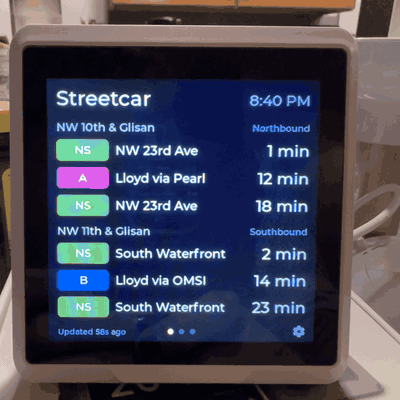

# TriMet Home Station Display

A small always-on display that shows live arrival times for the Portland Streetcar and MAX light rail at stops in my neighborhood (Pearl District / Old Town, near Union Station). It uses the TriMet Arrivals V2 web service.

<p align="center">
  
</p>

## Hardware

| Item | Detail |
|------|--------|
| Device | Seeed Studio SenseCAP Indicator D1S |
| MCU | ESP32-S3 (an RP2040 co-processor handles the onboard sensors, which this project doesn't use) |
| Display | 4" 480×480 RGB LCD with capacitive touch |
| Connectivity | Wi-Fi (2.4 GHz) |

## Software stack

- **Framework:** [ESP-IDF](https://docs.espressif.com/projects/esp-idf/)
- **Graphics:** [LVGL 8.3](https://docs.lvgl.io/8.3/) (bundled in `components/lvgl`; pinned to v8.3, do not use the v9 docs/APIs)
- **Starting point:** [Seeed-Solution/indicator-esp-idf-template](https://github.com/Seeed-Solution/indicator-esp-idf-template)
- **Data source:** [TriMet Web Services](https://developer.trimet.org/ws_docs/), mainly [Arrivals V2](https://developer.trimet.org/ws_docs/arrivals2_ws.shtml)

## Stops

Stop IDs and route lists come from the TriMet GTFS feed (`stops.txt`, `stop_times.txt`; feed dated 2026-10-07).

| Stop ID | Stop | Direction | Mode | Routes |
|---------|------|-----------|------|--------|
| 10772 | NW 10th & Glisan | Northbound | Streetcar | NS Line, A Loop |
| 10754 | NW 11th & Glisan | Southbound | Streetcar | NS Line, B Loop |
| 7601 | Union Station/NW 5th & Glisan MAX Stn | Southbound | MAX | Yellow, Orange |
| 7763 | Union Station/NW 6th & Hoyt MAX Stn | Northbound | MAX | Yellow |
| 8339 | Old Town/Chinatown MAX Station | Northbound | MAX | Red, Blue |
| 8378 | Old Town/Chinatown MAX Station | Southbound | MAX | Red, Blue |

The MAX stops are also served by shuttle buses 291 (Orange) and 293 (Yellow). These appear to be service-disruption shuttles.

All six stops fit in a single request: `locIDs=10772,10754,7601,7763,8339,8378`.

## TriMet Arrivals V2 API

**Endpoint**

```
GET https://developer.trimet.org/ws/v2/arrivals?locIDs=<id1,id2,...>&appID=<APP_ID>
```

**Request parameters**

| Param | Required | Notes |
|-------|----------|-------|
| `locIDs` | yes | Comma-separated stop IDs (up to 128). These are the GTFS `stop_id`s. |
| `appID` | yes | The developer key from registering at developer.trimet.org |
| `json` | no | Defaults to `true`; `false` returns XML |
| `minutes` | no | Look-ahead window. Defaults to 20, max 60. |
| `arrivals` | no | Minimum arrivals per route/direction. Defaults to 2. |
| `showPosition` | no | Includes vehicle `blockPosition` data. Defaults to `false`. |

**Response fields this project uses** (`resultSet.arrival[]`)

| Field | Use |
|-------|-----|
| `estimated` | Predicted arrival time (Unix epoch **ms**). May be missing when only scheduled data exists. |
| `scheduled` | Scheduled time (epoch ms). For streetcar it is the same as `estimated`. |
| `status` | One of `estimated`, `scheduled`, `delayed`, `canceled` |
| `shortSign` / `fullSign` | Destination text for display |
| `route`, `dir` | Route and direction for grouping |
| `locid` | The stop that the arrival belongs to |
| `routeColor` | Hex color for the route badge |
| `streetCar` | Marks streetcar results (streetcar data is included by default) |
| `reason` | Explanation when the arrival is delayed or canceled |

`resultSet.location[]` gives each stop's `id`, `desc`, `dir`, `lat` and `lng`. `resultSet.queryTime` is the server time in epoch ms, which can serve as a clock fallback.

**Notes**
- Arrival times are absolute, so the device needs accurate wall-clock time (SNTP). Alternatively, compute minutes-away from `queryTime`.
- HTTPS requires the ESP-IDF certificate bundle (`esp_crt_bundle`).
- The docs don't give a rate limit. We should poll politely, about every 30–60 s.
- The `appID` is a secret. It is entered on the device and never compiled into the firmware (see Configuration).

## Configuration

**Wi-Fi** is set up on the device itself, using the template's touchscreen Wi-Fi setup screen. Credentials are stored in NVS and survive reflashing.

**TriMet appID** is entered on the device: with no appID saved, the arrivals screen shows an **Enter App ID** button (also Settings → TriMet → App ID). It is saved in NVS, which survives reflashing and firmware updates. It is never compiled into the firmware, so release images can be published. The firmware logs only whether an appID is set, never the appID itself.

**On-device settings** (Settings → TriMet), saved in NVS:
- Check for arrivals every 30, 60, 90 or 120 s
- Show each page for 5–30 s, in 5 s steps

**Build-time settings** are in `idf.py menuconfig` → **TriMet Station Display** (`main/Kconfig.projbuild`):

| Option | Default | Notes |
|--------|---------|-------|
| `CONFIG_TRIMET_STREETCAR_STOP_IDS` | `10772,10754` | Streetcar page(s), 2 stops per page; streetcar arrivals only |
| `CONFIG_TRIMET_MAX_STOP_IDS` | `7601,7763,8339,8378` | MAX page(s), 2 stops per page; light rail only, so shuttle buses are hidden |
| `CONFIG_TRIMET_POLL_INTERVAL_SEC` | `30` | Default for the on-device setting |
| `CONFIG_TRIMET_PAGE_ROTATE_SEC` | `15` | Default for the on-device setting |
| `CONFIG_TRIMET_TZ` | `PST8PDT,M3.2.0,M11.1.0` | POSIX time zone for the clock and night dimming (US Pacific, with DST) |
| `CONFIG_TRIMET_OTA_URL` | latest GitHub release | Folder that firmware updates are fetched from |
| `CONFIG_TRIMET_STALE_RESTART_MIN` | `30` | Restart after this long without arrivals; 0 = never |

Streetcar and MAX stops together can total at most 8. The build is fully defined by `sdkconfig.defaults` plus these Kconfig defaults; `sdkconfig` is generated from them and is git-ignored. Changing a default in `Kconfig.projbuild` doesn't update an existing `sdkconfig`; change the value in menuconfig as well, or delete `sdkconfig`.

## Code layout

| Path | Purpose |
|------|---------|
| `main/trimet/trimet_parse.{c,h}` | Arrivals V2 JSON → `trimet_arrivals_t` (pure C + cJSON, host-testable) |
| `main/trimet/trimet_client.{c,h}` | HTTPS fetch + polling task; `trimet_client_get()` returns the last good snapshot and status |
| `main/trimet/trimet_format.{c,h}` | Display logic: sign → badge/destination, line colors, arrival selection, ETA text (host-testable) |
| `main/trimet/trimet_view.{c,h}` | LVGL arrivals screen (the start screen) |
| `main/trimet/trimet_settings.{c,h}` | Settings screens (opened from the cog): Wi-Fi (opens the template's Wi-Fi screen), Night dimming, TriMet, Firmware |
| `main/trimet/trimet_config.{c,h}` | On-device TriMet settings (appID, poll interval, page time) in NVS |
| `main/trimet/trimet_dimmer.{c,h}` | Night dimming: checks local time every 15 s and sets the backlight; settings saved in NVS |
| `main/trimet/trimet_health.{c,h}` | Restart reason/count in NVS, heap log, restart after too long without arrivals |
| `main/trimet/trimet_ota.{c,h}` | Firmware updates from GitHub releases, with rollback |
| `main/model`, `main/view`, `main/ui` | From the Seeed template (Wi-Fi, time, display, demo UI) |
| `test/host/` | Host unit tests for the parser, run against a captured live response |

**Notes on the live API data:**
- `estimated` is missing for schedule-only arrivals. The parser falls back to `scheduled`.
- Signs contain double spaces (`"MAX  Yellow Line"`). The parser collapses them.
- The `route` number doesn't always match the sign. Interlined MAX trips can show route 190 with an Orange Line sign, so the UI should label arrivals by their sign text.
- A bad appID returns **HTTP 403** in plain text. An unknown stop returns HTTP 200 with `resultSet.error.content`.

## Screen

Stops are shown 2 per page, with up to 3 arrivals per stop in the next 60 min. A stop list longer than 2 continues on another page with the same title. With the defaults there are three pages, each shown for 15 s (Settings → TriMet):

1. **Streetcar**: NW 10th & Glisan, NW 11th & Glisan
2. **MAX**: Union Station (5th & Glisan, 6th & Hoyt): Yellow, Orange
3. **MAX**: Old Town/Chinatown, both directions: Red, Blue


```
 Streetcar                          9:41 PM
 NW 10th & Glisan                Northbound
 [ NS ]  NW 23rd Ave                  5 min
 [ A  ]  Lloyd via Pearl             12 min
 NW 11th & Glisan                Southbound
 [ NS ]  South Waterfront             4 min
 [ B  ]  Lloyd via OMSI                 Due
 Updated 8s ago    o O o   Gray = scheduled  [cog]
```

- **Touch:** tap anywhere inside the center region (100 px border on all sides) to go to the next page. The page timer restarts on each tap. The 100 px border is reserved for other touch targets.
- **Settings:** the cog in the bottom-right corner opens Settings:
  - **Wi-Fi** shows the current network and opens the template's Wi-Fi setup screen; its back button returns to Settings.
  - **Night dimming** has an on/off switch, start/end times in 15-minute steps (default 10:00 PM to 6:00 AM) and a brightness slider (1–50%, default 10%) that previews on the backlight while dragging. Dimming waits until the clock has synced.
  - **TriMet** has the appID, poll interval and page time.
  - **Firmware** shows the version, checks for and installs updates, and shows uptime and unexpected restarts.

  All settings apply immediately and are saved in NVS, so they survive reboots, reflashing and updates.
- **ETA colors:** white = live estimate, gray = scheduled only, amber = delayed, red = canceled.
- **Countdowns:** computed from TriMet's server time plus the time elapsed since the fetch, so they don't depend on the device clock.
- **Footer:** shows how long ago data was fetched. It turns amber when the data is stale (more than 2 missed polls).

## Tests

```sh
make -C test/host      # parser + display-logic tests, built with ASan/UBSan; needs ESP-IDF's cJSON at $IDF_PATH
```

## Build & flash

Requires **ESP-IDF v5.1.7**, installed at `~/esp/esp-idf`:

```sh
mkdir -p ~/esp && cd ~/esp
git clone -b v5.1.7 --recursive https://github.com/espressif/esp-idf.git
cd esp-idf && ./install.sh esp32s3
```

Build:

```sh
. ~/esp/esp-idf/export.sh
idf.py set-target esp32s3     # first time only
idf.py build
idf.py -p /dev/cu.usbserial-XXXX flash monitor
```

Board config lives in `sdkconfig.defaults` (`CONFIG_LCD_BOARD_SENSECAP_INDICATOR_D1=y` for the D1/D1S). If you change `sdkconfig.defaults`, delete `sdkconfig` so it gets regenerated.

Local builds are versioned from `git describe` (e.g. `6b546e6-dirty`), which the update check treats as older than any release.

## Updates & releases

Pushing a version tag builds and publishes a GitHub release (`.github/workflows/release.yml`):

```sh
git tag v1.1.0 && git push origin v1.1.0
```

The release has `trimet_station_display.bin` (the app, for updates), `version.txt` (the tag) and `trimet_station_display_full.bin` (bootloader, partition table and app, for a first install at offset `0x0`). Releases are built from `sdkconfig.defaults` only, so they contain no appID.

On the device, **Settings → Firmware → Check for update** compares `version.txt` from the latest release with the running version, and **Install** downloads the new image into the other OTA slot (`partitions.csv` has two 3.5 MB slots) and restarts. The new image is on probation until it has run for 5 minutes and fetched arrivals. If it restarts before then, whether from a crash, a watchdog or the no-data restart, the bootloader goes back to the previous image, and Settings → Firmware says the update was undone. Arrivals polling pauses during a check or download.

Update checks need the repository to be public (or `CONFIG_TRIMET_OTA_URL` to point at another HTTPS folder with the same two files).

## Reliability

- A crash or watchdog timeout reboots the device (the template halted, leaving a black screen) and saves a core dump to flash: read it over USB with `idf.py coredump-info`. The panic handler runs from IRAM so it can report a stuck cache.
- The task watchdog also watches the LVGL task, so a frozen screen reboots.
- After 30 min without arrivals (not counting a missing or rejected appID), the device restarts.
- TLS uses software SHA/AES: in ESP-IDF 5.1 the hardware drivers flush the PSRAM cache without the lock the LCD driver uses, and the two cores deadlocked.

### Changes from the upstream template
- Board set to D1/D1S (upstream defaults to D1L/LoRa)
- Project renamed to `trimet_station_display`
- Added the missing `#include "esp_timer.h"` in `main/model/indicator_time.c` and `indicator_btn.c`, which are required on IDF 5.1.7
- Added `ui_set_screen_last()` to `main/ui/ui.c`, so the Wi-Fi screen's back button can return to our screens
- `main.c` loads the arrivals screen at startup instead of the template's time screen
- `indicator_time.c`: `__time_zone_set()` uses `CONFIG_TRIMET_TZ` when set. The template's IP lookup sets a fixed UTC offset that doesn't follow DST, and it geolocates this device to Seattle.
- `sdkconfig.defaults`: `CONFIG_MBEDTLS_EXTERNAL_MEM_ALLOC=y` puts TLS buffers in PSRAM. Internal RAM is shared with LVGL and ran out during concurrent HTTPS requests.
- `sdkconfig.defaults`: reboot on panic, task watchdog panics, core dump to flash, app rollback, software SHA/AES (see Reliability).
- `partitions.csv`: two OTA slots and a core dump partition instead of one 4 MB factory app.
- `main/lv_port.c`: the LVGL task is watched by the task watchdog, and the direct-mode copy flushes the cache through `esp_cache_msync()` (which takes the cache lock).

## Project status

The arrivals screen (Streetcar and MAX pages) runs on the device. See [TODO.md](TODO.md).
